# NOREZ CORP S.A.C. – Website Corporativo

<p align="center">
  <strong>Plataforma web corporativa desarrollada con Laravel 8</strong>
</p>

---

## 📌 Descripción del proyecto

**Norez Corp S.A.C.** es un sitio web corporativo desarrollado para una empresa especializada en publicidad exterior, publicidad gráfica, impresión y soluciones visuales para empresas y negocios.

La plataforma permite presentar los servicios de la empresa, mostrar proyectos realizados, comunicar información corporativa y facilitar el contacto con potenciales clientes a través de formularios y canales de comunicación digitales.

El proyecto cuenta con un panel administrativo que permite gestionar contenidos del sitio web, facilitando la actualización de información y la administración de diferentes secciones de la plataforma.

🌐 **Sitio web:** [https://norez-corp.com/](https://norez-corp.com/)

---

## 🚀 Tecnologías utilizadas

| Tecnología | Descripción |
|---|---|
| PHP | Lenguaje de programación backend |
| Laravel 8 | Framework de desarrollo web |
| MySQL | Sistema de gestión de base de datos |
| Blade | Motor de plantillas de Laravel |
| HTML5 | Estructura de páginas web |
| CSS3 | Diseño y estilos |
| JavaScript | Interactividad del frontend |
| Bootstrap | Framework de diseño web |
| Composer | Gestión de dependencias PHP |
| NPM | Gestión de dependencias frontend |
| Laravel Mix | Compilación de recursos frontend |
| Git | Control de versiones |

---

## ✨ Características principales

### 🌐 Sitio web público

- Página de inicio corporativa.
- Presentación de la empresa.
- Sección de proyectos y trabajos realizados.
- Catálogo de servicios publicitarios.
- Presentación de soluciones de publicidad exterior.
- Información corporativa.
- Formulario de contacto.
- Solicitud de cotizaciones.
- Presentación de clientes y referencias.
- Sección de noticias y contenidos informativos.
- Diseño adaptable a diferentes dispositivos.

### 🏢 Servicios presentados

Entre los servicios que ofrece la empresa a través de su plataforma:

- Paneles publicitarios en vía pública.
- Backing, displays y roll screen publicitarios.
- Módulos de venta y exhibición.
- Letreros luminosos publicitarios.
- Cajas luminosas para negocios.
- Letras corporativas publicitarias.
- Soluciones de publicidad gráfica y visual.

### ⚙️ Panel administrativo

El sistema incluye funcionalidades de administración de contenidos para facilitar el mantenimiento de información del sitio web.

- Gestión de contenidos.
- Administración de información corporativa.
- Gestión de elementos y contenidos relacionados con el sitio.
- Administración de información publicada.

---

## 🖥️ Capturas de pantalla

Las siguientes imágenes muestran algunas de las principales interfaces y funcionalidades del sitio web corporativo y su panel administrativo.

### 🌐 Sitio web público

#### Página de inicio

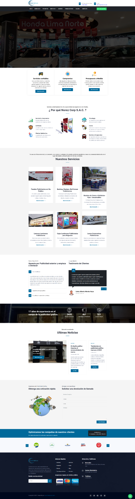

#### Galería

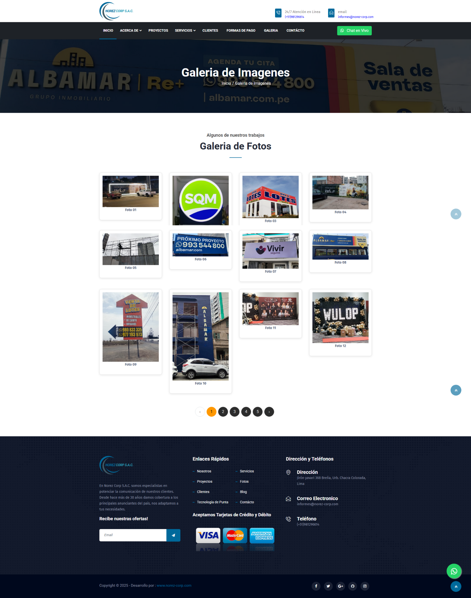

#### Proyectos

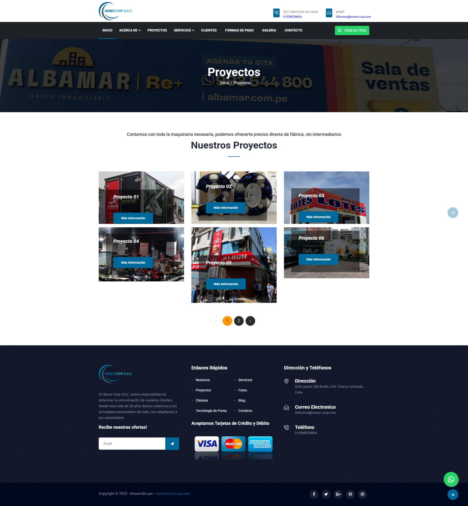

#### Contacto

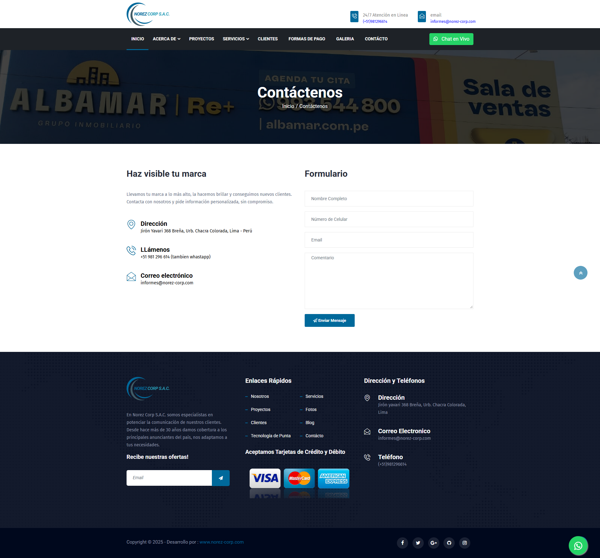

---

### ⚙️ Panel administrativo

#### Inicio de sesión

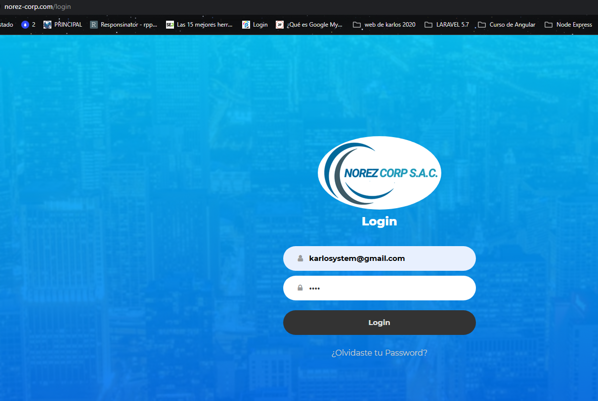

#### Dashboard administrativo

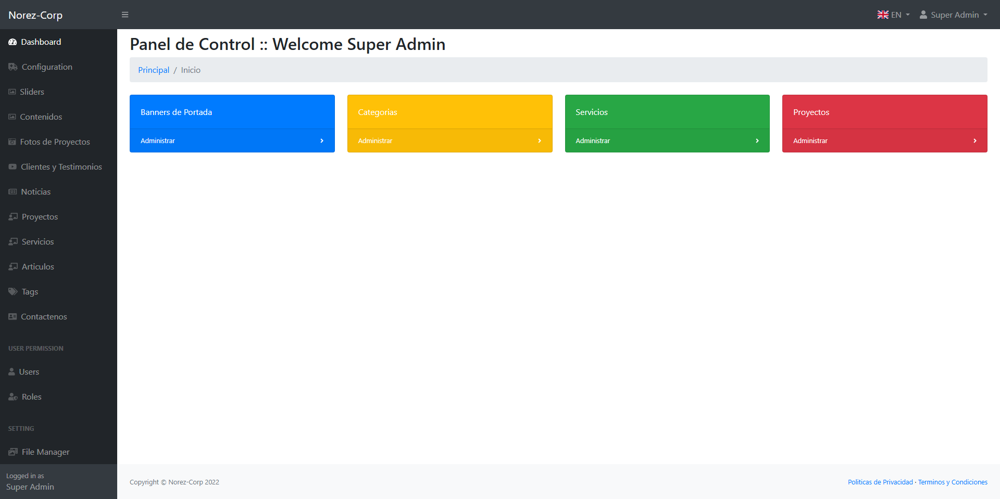

#### Gestión de artículos

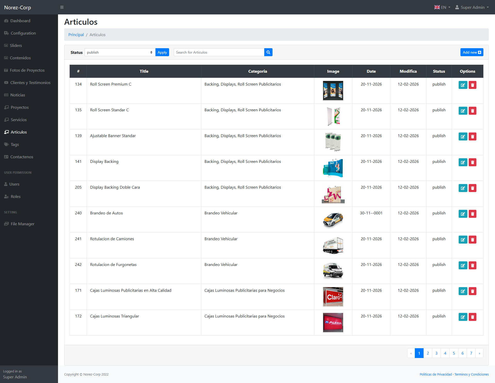

#### Creación de artículos

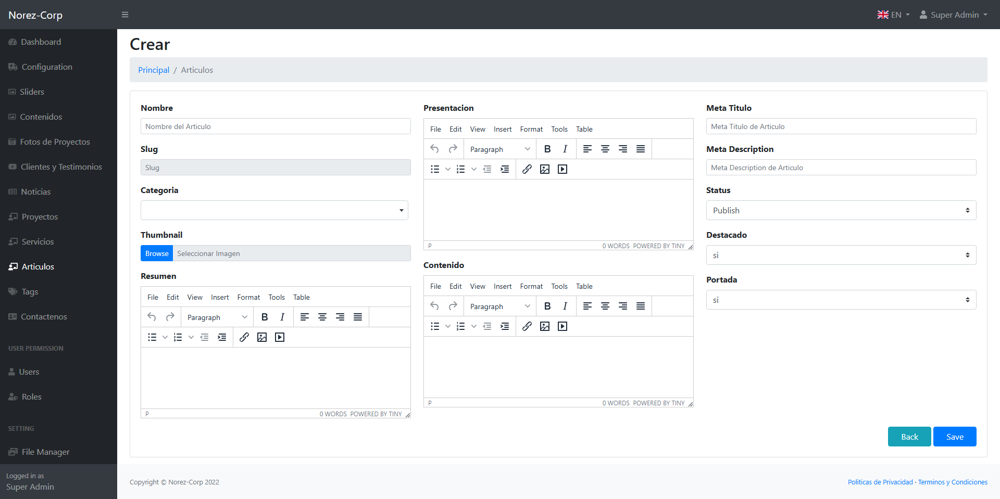

#### Gestión de clientes

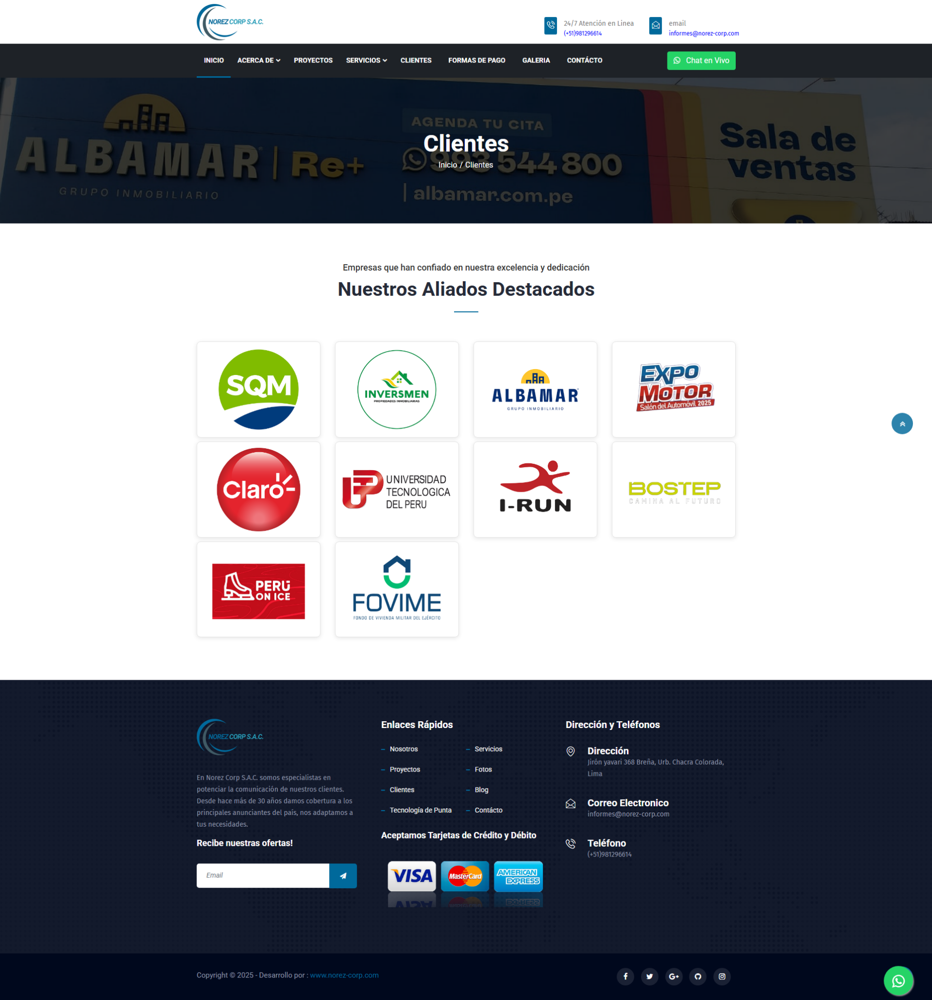

#### Gestión de formas de pago

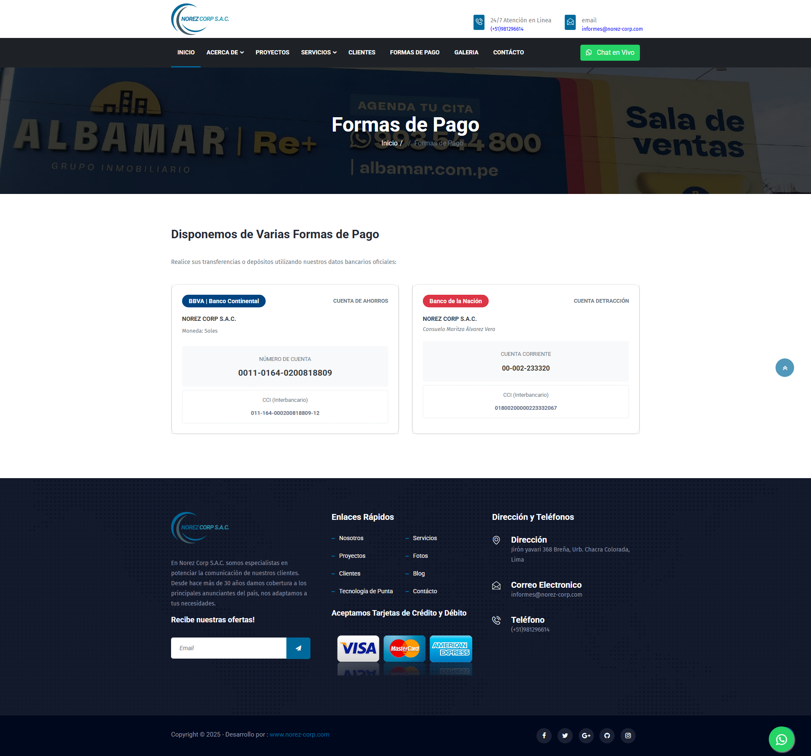

#### Gestión de sliders

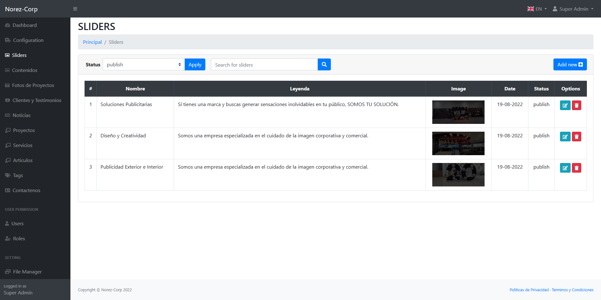

---

## 📂 Estructura del proyecto

El proyecto está organizado siguiendo la estructura de aplicaciones Laravel.

```text
NOREZ-CORP-LARAVEL8/
│
├── app/
│   ├── Http/
│   ├── Models/
│   └── ...
│
├── assets/
│   └── screenshots/
│       ├── articulo-crear.png
│       ├── articulos-listado.png
│       ├── clientes.png
│       ├── contacto.png
│       ├── dashboard.png
│       ├── formas-de-pago.png
│       ├── galeria.png
│       ├── inicio.png
│       ├── login.png
│       ├── proyectos.png
│       └── sliders.png
│
├── bootstrap/
├── config/
├── database/
├── public/
├── resources/
│   ├── views/
│   ├── css/
│   ├── js/
│   └── ...
│
├── routes/
├── storage/
├── tests/
│
├── artisan
├── composer.json
├── composer.lock
├── package.json
├── webpack.mix.js
└── README.md
